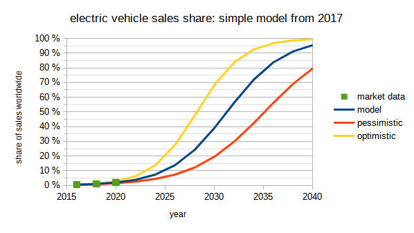
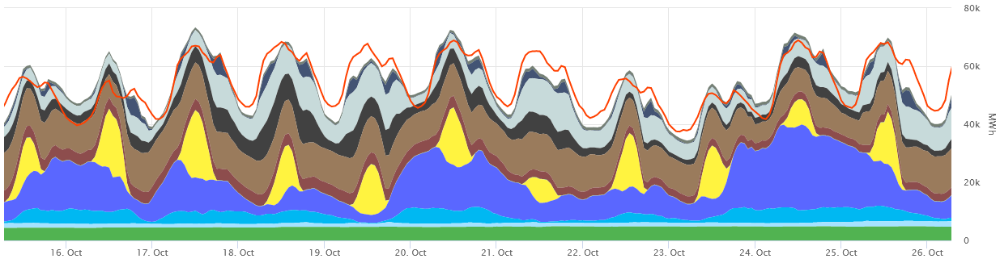
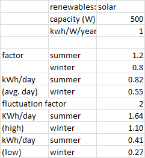
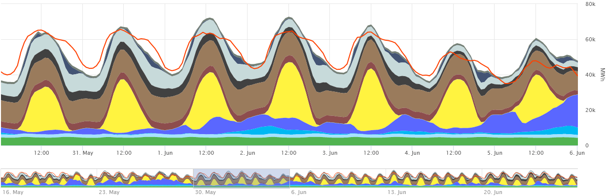

The target of this post is to build a baseline mental model of energy supply and CO2 reduction on a country-wide level. Be warned that "baseline model" is way less than a detailed expert model: the model serves as a robust rough guide to the state of the world, but there are a lot of small details missing. [^1]

My summary is that an (allmost) CO2-neutral society is feasible with today's technology and in reach within 20 years or so. The good news is that we are getting there. Also it will be pretty wild and very interesting.

The post consists of three parts (total ~5000 words, reading time ~30 minutes):

* Part 1 introduces a set of reference problems or mental models that I found necessary to discuss all this.
* Part 2 tries to match these fundamentals and fit the puzzle pieces into a coherent picture.
* Part 3 is a summary and discussion of my findings. You may want to read this first.

# Part 1: Base Problems To Keep in Mind 

Don't have enough problems yet? Here you go.

(If this feels like a drag to read, consider to jump ahead to part 2 and come back for these later)

## 1.1: A Problem Of Scales

We often fail to appreciate the scales we're dealing with. But things are only practically feasible if they are available on the right scale. Base numbers:[^2]

* An average person consumes ~1.500 kWh of electricity per year (compare this to the number on your electricity bill to see how you're doing)
* Germany as a whole consumes ~500 TWh of electricity per year, or ~6.000 kWh per person and year (~84M inhabitants). Only 25% is private consumption, another ~30% "trade and services" and ~40% industry.
* Total energy consumed is ~3500 TWh or 40.000 kWh per year and person. So only 8% of this is electricity. 33% of all energy consumed is from oil, another 25% is gas and 17% is coal - that's 75% fossile sources and only 25% "green" (includes 4%. nuclear as of 2021, so depending on whom you ask that doesn't count as green. Also 8%. wind, 3%. solar)
* Energy consumption is 2:2:2:1 households:transport:industry:trades&services. I haven't yet found good data on how this is spread over seasons - electricity production is [30% higher in winter than summer](https://www.zeit.de/wirtschaft/energiemonitor-deutschland-gaspreis-spritpreis-energieversorgung). I'd expect this to be stronger for overall consumption (as it includes more heating) and glancing at the split of sources, it might very well be 2x higher overall energy consumption in winter than in summer (read as: one third of total energy use is in the warmer 6 months and two thirds are in the colder 6 months). There's a more detailed breakdown of energy flows by [AG Energiebilanzen e.V. here](https://ag-energiebilanzen.de/wp-content/uploads/2022/04/Energieflussbild-2020_PJ_lang_EN_20220405.pdf). 

Some context and plausiblity checks:
* Carbon emission is ~0.2 kg/kWh, so 40.000 kWh per year and person equal 8T of CO2 per year and person. If we want to reduce that, we'd have to either reduce the amount of energy consumed or the CO2-ness of it's source. Also there's additional carbon emitted by chemical processes (e.g., concrete) and CO2-equivalent stuff (e.g., methane from cows). So total CO2-equivalent is more like 11 T of CO2-equivalent per person and year.
* By changing energy source, amount of energy consumed may change, too. Combustion-driven cars have 20..30% efficiency and use 5..9 l/100 km of gasoline = 60..100 kWh per 100 km; electric vehicles consume 15..20 kWh per 100 km. A heat pump should have a [coefficient of performance of 2..4](https://en.wikipedia.org/wiki/Heat_pump#Performance), so replacing a gasoline heater with a heat pump ideally reduces "energy consumed" by a factor 2..4. So assuming a factor 2 of improvement for switching all of today's energy need to electrified sources would imply a reduction of total energy demand from 40 MWh per person mentioned above to 20 MWh (again, really rough estimate).
* The seasonality effects mentioned above still imply we have to store something like 5 MWh per person from summer to winter. This is way above the storage potential of batteries of all kinds: You'd need the equivalent of 100 electric vehicles per person to provide enough storage for seasonal compensation (at 50 kWh per vehicle).

## 1.2: A Problem Of Limits To Growth

Limits change over time: Growth may be exponential, but occurs at limited rates nonetheless. Actually, nothing is exponential - there are limits to how far you can push something. [^3]

* solar power: 5 GW added per year, growing (target is increase to 22 GW/year in 2026; 1 W of capacity yields something like [1kWh of electricity per year](https://www.oeko-energie.de/shop1/de/Solarstrom/Solarmodule/Solarmodul-Wissen/Leistung--bzw--Ertrag-eines-Solarmodules/); so with 84M people we get 5GW = ~60 kWh per person and year; 22 GW = ~260 kWh per person and year). Prices follow [Swanson's law](https://en.wikipedia.org/wiki/Swanson%27s_law#/media/File:Solar-pv-prices-vs-cumulative-capacity.png) and reduce by half every 5 years or so. Limits to growth: I haven't checked but it looks as if there's enough space to mount these on and enough Silicium to build them from.
* wind power: ~2 GW added per year (target is increase to 7.8 GW/year in 2025; [64 GW installed power yield ~130 TWh per year](https://strom-report.de/windenergie/), so 1 W translates to ~2kWh of electricity per year). Here I'm confused on the amount of space left but apparently a [3x increase from 0.5..0.8% to 2% of land available for wind power](https://www.bundesregierung.de/breg-de/themen/klimaschutz/wind-an-land-gesetz-2052764) is at least theoretically possible.
* biomass / biogas: I've only had a quick glance at [Biomass - Wikipedia](https://en.wikipedia.org/wiki/Biomass), but it looks like a factor 2..3 increase may be the best case and then we've maxxed out the amount of plants we can grow.
* [pumped storage](https://en.wikipedia.org/wiki/Pumped-storage_hydroelectricity): currently at [40 GWh capacity in Germany](https://de.wikipedia.org/wiki/Pumpspeicherkraftwerk#Deutschland_2) (~0.5 kWh per person). Potential for growth is limited to another 7 GWh in Germany, 8 GWh in Austria, but >100 GWh for France, Spain, Italy, Switzerland, Greece and ~1300 GWh for Norway ([pg. 40 here](https://www.bves.de/wp-content/uploads/2016/05/eStorage_Studie-1.pdf)). More details [in this report (german)](http://www.weltenergierat.de/wp-content/uploads/2014/04/PDF-5_prognos_bericht_internationale_speicherung_wec_9_okt_2012.pdf) - especially there's a large difference between amount of water stored in dams (filled by rivers and available on demand, e.g. 3TWh in Austria) and amount of water available to pump up hills (can behave like batteries to store excess power from the grid, that's what the numbers above refer to).
* battery storage: currently at [0.75 GWh in Germany but this report argues that something like 60 GWh is possible until 2030](https://www.ise.fraunhofer.de/de/leitthemen/stationaere-batteriespeicher/grossspeicher.html). The report estimates costs at currently ~500 €/kWh and a ~2x drop in costs until 2030 (simplified by me, more details in source)
* other medium-term storage: see [here](https://en.wikipedia.org/wiki/Energy_storage) for an overview and [here](https://en.wikipedia.org/wiki/List_of_energy_storage_power_plants) for a list of large-scale storages. Thermal storage is a thing for a few hours..days and molten salt for a few hours. 

## 1.3: A Problem Of Externalities

There's a simple rule of thumb that we can usually expect secondary effects to be small, like maybe 10% of the main direct effect of something we observe. That's not zero, but in first approximation we may ignore the secondary effect of something and still get the order of magnitude right. But "usually" is not always, especially not with energy production: Here the base rule of thumb is that secondary effects may be stronger than primary ones. Let's go through a few common options and think about unintended consequences:

* Coal: baseline price ~[10 ct/kWh electricity](https://en.wikipedia.org/wiki/Economics_of_nuclear_power_plants#/media/File:3-Learning-curves-for-electricity-prices.png); emits lots of CO2 (~[1 T CO2 per MWh](https://ourworldindata.org/explorers/impacts-of-energy-sources), equals 10 ct/kWh at a CO2 price of 100 €/T). Deaths from cancer caused by should add ~25 ct/kWh (based on 10 M€ per life and [25 deaths per TWh](https://ourworldindata.org/safest-sources-of-energy)).
* Oil is almost identical to coal except for baseline costs and handling (easier to work with on a small scale, like cars and house heating; not so great for steel production)
* Gas: mostly like coal but with modified numbers: baseline price ~20..40 ct/kWh of electricity (depending on current gas prize, got a lot more expensive in 2022 due to a certain war), ~[0.4 T CO2 per MWh](https://ourworldindata.org/explorers/impacts-of-energy-sources), [factor 10 lower deaths per energy](https://ourworldindata.org/safest-sources-of-energy) than coal. 
* Nuclear: production cost after building the plant ~3 ct/kWh. Production costs are usually projected to add ~5 ct/kWh, but these are megaprojects with cost escalation, so expect something like 10 ct/kWh. I don't know how to factor in risk of nuclear incidents, costs of waste storage and risk of nuclear war by having plutonium available everywhere. Estimates are all over the place, e.g., I've seen ~30 ct/kWh for long-term waste storage and >100 ct/kWh if you'd try to actually insure against all nuclear risks (both numbers from people who probably don't like nuclear)
* Wind: These days baseline price of 5 ct/kWh for new plants. Power output fluctuates wildly, expect factor X variation between "not very much wind" and "lots of wind" ([but with stronger winds in autumn and winter](https://en.wikipedia.org/wiki/Solar_power#/media/File:Seasonal_cycle_of_capacity_factors_for_wind_and_photovoltaics_in_Europe_under_idealized_assumptions.png)). Given the fluctuations, you need a significant battery capacity to buffer fluctuations that should increase costs significantly (maybe another 5 ct/kWh). Wind turbines produce noise, interfere with birds, planes and everything else (e.g., whales if you build them offshore). Ideally, you can place them somewhere noone minds but in a densely populated country, there's a shortage of that.
* Solar: These days baseline price of ~10 ct/kWh for new installations on rooftops, ~5 ct/kWh for standalone / large scale installations, I've heard ~2 ct/kWh for large installations in spain). Power output fluctuates wildly: zero at night, [factor 3](https://en.wikipedia.org/wiki/Solar_power#/media/File:Seasonal_cycle_of_capacity_factors_for_wind_and_photovoltaics_in_Europe_under_idealized_assumptions.png) between spring/summer and autumn/winter due to daylight lenght and cloud intensity. Given the fluctuations, you need a significant battery capacity to buffer fluctuations that should increase costs significantly (maybe another 5 ct/kWh).

## 1.4: A Problem Of Perspectives

Curves often look smooth when sufficiently zoomed out, but change may feel very disruptive if you're directly affected. Effects will not apply to everyone the same way - an increase in gas costs doesn't matter at all if you're in a well-insulated house with a heat pump but very much if you're a small-income family in an old house. Timescales will differ on your perspective. 

To illustrate, here's a simple model on the market transition of electric vehicles I pulled together in 2017. Feel free to compare with [how the market has developed since](https://en.wikipedia.org/wiki/Electric_car_use_by_country#Statistics) - so far it's been surprisingly accurate:

This is not about the transition to electric vehicles but about a larger point. Assuming the model above is correct, can we appreciate for a moment how different such a transition feels depending on one's perspective?

* If you're doing future developments for cars, it's basically clear where we're headed since 2018 (± 2 years, depending on who you ask).
* If you're working on an assembly line at a car supplier, you're starting to see that change now, but it will really hit you in the years until 2030.
* Sales of new cars may switch to electric vehicles now, but people will still drive old cars with combustion engines in 15 years from now. Hey, you might even get one really cheap!
* The model above looks really smooth, but if you're working somewhere in a combustion-engine-dependent industry, that transition will feel really bumpy.

In the scope of this discussion here, I mostly assume that electrification of very large industries will happen inevitably (including but not limited to cars). In most cases, I have reasonably high confidence that this is what we'll see and that actual implementation details will work out one way or the other (and I'm wary of debating what kind of battery or charging system will be the core thing in 15 years from now; this just misses the point here - what matters is that there will be a solution one way or the other). 

You might disagree and a large share of our disagreement will probably result from different perspectives. I don't always know how to factor in all of these disagreements. At least, I try my best not to forget them.

# Part 2: A Baseline Model Of Energy Transition

Let's try to put all of this together.

## 2.1: Fiddely Fluctuations

https://www.smard.de/en has data on hourly energy production in Germany. Things that really stood out for me:

1) Renewables now make up a significant part of Germany's electricity production, close to 50%. But they fluctuate wildly! Much of this gets compensated by in- and decreasing coal-powered electricity, but we've definitely hit a limit of this and in high-supply cases (= more renewables get produced than there's energy demand). Honestly I'm surprised our grid can tolerate that much fluctuation, with wind power being mostly in the north.

(a few days from October 2022 in the [SMARD data viewer](https://www.smard.de/en/marktdaten?marketDataAttributes=%7B%22resolution%22:%22hour%22,%22from%22:1665808917927,%22to%22:1666759317926,%22moduleIds%22:%5B1004066,1001226,1001225,1004067,1004068,1001228,1001224,1001223,1004069,1004071,1004070,1001227,5000410%5D,%22selectedCategory%22:null,%22activeChart%22:true,%22style%22:%22color%22,%22categoriesModuleOrder%22:%7B%7D,%22region%22:%22DE%22%7D). The red curve is total demand, so there's also some import/export going on that fills the difference)

2) Basically, we've reached a level of renewables where higher shares are only possible by either accepting unused excess power in high-supply situations or adding significantly more storage to the grid. Maybe both. This matches other sources I've seen claiming that at wind/solar above 30..40% of total electricity generated, you need buffering. 
3) Following a rough "factor 2 of fluctuation per day"-model, we'd need capacity to buffer something like 1 day of electricity in storage (to compensate for 2 bad days in a row). That would be something like 6 MWh per year / 365 days = 16 kWh per person. Thats… wow, that's just huge. I don't see a way adding that much storage to the grid at battery prices of 500€ per kWh, that's like an order of magnitude too high (rough estimate: if you pay 50€ per kWh and year and use that 100 times per year, that's still 50 Ct/kWh of stored energy). I'm not saying we won't need storage, just that storage in the size of "buffer energy for 2 days of low wind+sunshine" is very unlikely to be available in the next ~10 years.

## 2.2: Renewables Rampup

OK, so forget the storage, what if we just ramp up renewables? Let's just build enough solar and wind and accept that they usually produce more energy than we need!

Rough estimate: Assuming sufficient buffering is available, we'd need another ~5 MWh * 84M people = 420 TWh of renewable generation to hit close to 100% renewable electricity generation. Maybe more like 10 MWh per person if we shift all kinds of stuff to electricity. We plan to add something like 15 TWh of wind and 20 TWh of solar per year from 2025 on, so we'll reach the "close to 100%"-point some time after 2030, probably more like 2040. 

Can we do better? Let's see: I built a spreadsheet-based model of energy supply and demand by taking average energy production and splitting it over the year by defining a summer and winter share and a fluctuation share to distinguish between good and bad days. (Again, all numbers on a per-capita base)

We can do the same with wind (same capacity, but better yield at 2 kwh/W/year + summer/winter shares reversed) and with "others" (mostly biomass, so no fluctuation) ab a constant 50 W. For 2020 and against 6 MWh/year base consumption, the model predicts an average share of 37% renewable electricity but fluctuation between 62% on good summer days and 18% on bad winter days, so at least it's not totally off.

So long story short, the model's representation for 2020 would be something like:

| year | demand | capacity solar | capacity wind | share renewables |
|------|--------|----------------|---------------|------------------|
| 2020 | 6 MWh  | 500 W          | 500 W         | 37 %             |

This is a very much condensed view with really coarse estimates and a lot of secondary parameters hidden, but I don't trust the model too much anyways, so let's not pretend having accuracy where there isn't. In any case, we can now make wild guesses about future developments: An optimistic guess would be something like 250 W solar and 100 W wind to be added for each year after 2026 (per person, so ~21 GW solar and ~8 GW wind for the whole of Germany). Assuming a constant demand of 6 MWh, good days would be 100% renewable in 2030 and average days would be 100% renewable in 2040:

| year | demand | capacity solar | capacity wind | share renewables | excess renewables |
|------|--------|----------------|---------------|------------------|-------------------|
| 2020 | 6 MWh  | 500 W          | 500 W         | 37 %             | 0 MWh             |
| 2030 | 6 MWh  | 2000 W         | 1000 W        | 72 %             | 0.4 MWh           |
| 2040 | 6 MWh  | 4500 W         | 2000 W        | 93 %             | 2.4 MWh           |

But demand will not remain at 6 MWh as we're shifting more stuff towards electricity. Let's make another wild guess here and assume demand will double until 2040, then we'd have to cope with 12 MWh per person and year.

| year | demand | capacity solar | capacity wind | share renewables | excess renewables |
|------|--------|----------------|---------------|------------------|-------------------|
| 2020 | 6 MWh  | 500 W          | 500 W         | 37 %             | 0 MWh             |
| 2030 | 9 MWh  | 2000 W         | 1000 W        | 56 %             | 0.05 MWh          |
| 2040 | 12 MWh | 4500 W         | 2000 W        | 72 %             | 0.9 MWh           |

I'm still impressed by how much power we could add. Up to a total of ~70% renewables, the model expects this to work without that much excess energy (renewable energy that ends up unused), 80% renewables are still reasonably reachable but everything above that really pushes you towards a lot of power going unused.

## 2.3: Better Batteries

The scenarios above are calculated on a day-by-day basis, so there's still the open point of how to deal with missing solar in the night. Currently there's ~0.5 kWh per person of storage available and I'd expect that to get increased to ~1 kWh by 2030 (mostly via lithium-based batteries), so probably that'll just be enough to do some helpfull short-term buffering. Also there will probably be lots of flexible consumption: if there's enough incentive you may be willing to shift the charging schedule of your car or heat-up schedule of your heat pump by a few hours. Also there's [thermal storage](https://en.wikipedia.org/wiki/Thermal_energy_storage) as a reasonable option to buffer energy for a few hours on a grid scale.

Still, it would be really really great if we had batteries at a pricetag of 50 €/kWh or lower. There are actually a few candidates to get there, with [redox flow batteries](https://en.wikipedia.org/wiki/Flow_battery) my personal bet for how that might actually look like. I don't expect this to arrive on a relevant scale before 2030, but I cannot stress enough how helpful large and cheap storage actually would be.

## 2.4: Happy Hydrogen

The model in 2.2 suggests that we can …

1. Shift most of today's fossile fuel consumption towards electricity (but this will increase electricity demand by something like a factor of 2).
2. Build enough solar and wind until 2040 so that ~70% of that electricity will be renewable.

What about the last 30% and what about difficult-to-electrify technologies like [ships and planes](https://www.theguardian.com/environment/ng-interactive/2021/nov/11/climate-fuel-gasoline-petrol-ships-planes) or [ammonia / fertilizers](https://en.wikipedia.org/wiki/Ammonia_production)? Turns out that potentially we could do those if we had enough green hydrogen. So green hydrogen production could be something like [500 MT worldwide in 2040](https://fcarchitects.org/wp-content/uploads/2022/12/20220902_Factsheet_Hydrogen_English_print_proof.pdf) (versus 73 MT today) and there's a [european hydrogen strategy](https://energy.ec.europa.eu/topics/energy-systems-integration/hydrogen/key-actions-eu-hydrogen-strategy_en) that includes a [hydrogen backbone](https://www.ehb.eu/page/european-hydrogen-backbone-maps) ([transport costs ~20 ct / 1000 km and kg of hydrogen](https://www.ehb.eu/page/estimated-investment-cost) - remember 1 kg hydrogen = 34 kWh of stored energy).

The model in section 2.2 ends with an estimated consumption of 12 MWh electricity per person and year for 2040 and with a 70% renewable shares, so there'd be something like ~4 MWh missing that hydrogen would have to fill in. That equals ~120 kg hydrogen per person and year (at 34 kWh/kg, with some losses added on top) - or ~10 MT for germany, ~50 MT for the european union (this is missing industrial use, so feel free to generously round this up by another 50% or something). These 4MWh per person could be created from excess energy in a very local way, but a transport network could utilize pretty large advantages for Mediterranean countries with very cheap solar electricity.

So hydrogen should be able to fill in for the missing renewables… conditional on us building a hydrogen backbone, having enough electrolysis capacity at places with constant excess renewables and converting all affected processes to hydrogen. Still, it's doable in principle.

# Part 3: Summary

Part 2 is mostly a collection of small puzzle pieces and an attempt to assemble them into a coherent model. That model is introduced in section 2.2 and consists of a few assumptions (4th and 5th added afterwards):

1. How energy demand might evolve: electricity demand goes up by a factor of 2 while non-electrical demand goes down 
2. How renewables might evolve: solar and wind will increase by 250W and 100W/year respectively starting 2025, the rest doesn't matter too much
3. A very simple excel sheet to calculate how much of the electricity output will be carbon-free: batteries don't allow for significant multi-day storage, wind and solar will have difficulty providing >>70% of all electricity demand 
4. Section 2.4 then introduces green hydrogen as an answer to "where do we get the other 30% from". I'm making some very wild guesses on availability here, but something like 1MWh per person and year until 2030 and 5 MWh until 2040 seems possible.
5. I decided to throw in an ad-hoc estimation of CO2 emissions by (fossile demand = total demand - el. demand * share_renewables - green_hydrogen_used) and (CO2 = fossile_demand * 0.25T/MWh). I don't think this is way worse than any other assumption made along the way, so let's take that as a really rough guide.

Integrated into the summary table from section 2.2, this would look something like this:

| year | total demand (1) | el. demand (1) | capacity solar (2) | capacity wind (2) | electricity from wind + solar (3) | green hydrogen used (4) | CO2 / year (5) |
|------|------------------|----------------|--------------------|-------------------|-----------------------------------|-------------------------|----------------|
| 2020 | 40 MWh           | 6 MWh          | 500 W              | 500 W             | 37 %                              | 0 MWh                   | 9.5 T          |
| 2030 | 30 MWh           | 9 MWh          | 2000 W             | 1000 W            | 56 %                              | 1 MWh                   | 6.3 T          |
| 2040 | 20 MWh           | 12 MWh         | 4500 W             | 2000 W            | 72 %                              | 5 MWh                   | 1.6 T          |

So long story short, this is my best understanding of how the transition from ~10 T CO2 per person and year down to <2 T per year could look like for Germany. As far as I can tell, assumptions 1-5 are compatible with all the constraints I put on the table in part 1 and with the current policy of Germany and the EU (more on other countries below).

## Consequences And Confidences

How confident am I that my model is correct? Well, no model is ever true, but that's besides the point.

I am pretty confident that the picture I paint here is roughly correct for Germany for the next 10 years. I'd expect CO2 emissions to decrease towards 2030 but I don't think there's a way to reduce them by more than 50% in such a short timespan without severe consequences (like a very strong deindustrialization). I am also somewhat confident that Germany will reach a <2 T CO2 per person somewhat around 2040 (± 5 years), but other technologies than solar, wind and hydrogen might play a role (see next section). Assuming no weird wildcard occurs (3rd world war, general artificial intelligence destroying the world, whatever) I'd probably be willing to place a bet on this being the actual outcome (that's a complicated way of saying I believe this has >50% chance of happening).

I am way less confident that this is exactly how it'll play out in other countries. One reason for this is that Germany decided to ditch nuclear energy, so I don't have to factor that into my model here (I don't have a strong personal opinion on that one, I'd just be very surprised if that decision got reversed in the current political climate). Also there are a few other technologies we could see in 10..15 years that might play a large role for other countries. Let's tackle them in the next section.

So one really nice consequence is that this looks better than I thought. I come away from this believeing that we can decarbonize a very large industrial country (and ideally the whole world) without loosing much of the comfort luxuries we've gotten so accustomed to (without checking too closely I assume this would be something like a 2°C scenario for global warming). I also come away from this believing that the energy supply in Germany in 20 years from now will be a lot weirder and different from what is there today than most of us expect it to.

That weirdness results a large part in accepting the very-much-fluctuating nature of solar and wind. This is a good week in early summer 2022:

(May 30th to June 6th 2022 in the [SMARD data viewer](https://www.smard.de/en/marktdaten?marketDataAttributes=%7B%22resolution%22:%22hour%22,%22from%22:1665808917927,%22to%22:1666759317926,%22moduleIds%22:%5B1004066,1001226,1001225,1004067,1004068,1001228,1001224,1001223,1004069,1004071,1004070,1001227,5000410%5D,%22selectedCategory%22:null,%22activeChart%22:true,%22style%22:%22color%22,%22categoriesModuleOrder%22:%7B%7D,%22region%22:%22DE%22%7D). Again, the red curve is demand).

So what will happen if we scale solar by a factor of 4? Demand will also grow, but these will definitely be the days with excess electricity being available the model refered to. So at least if you run your own solar, there will be cases of "if you don't want to use the electricity right now, noone else will" where the market price for electricity is close to zero.

There should be a pretty high incentive to build something like smart demand structures that use those "almost free" electricity peaks and avoid high cost-situations. There are probably some smart and some not-so-smart solutions of how to bring market mechanisms into play here, but I'm pretty sure there will be at least some incentive structure in place. My current position is that I'd really like to see a "you pay minute-by-minute the current price"-option implemented, at least to find out how well that'll work.

Also based on all of this, I find it really difficult to predict how expensive power will be in the medium term. Today's electricity costs are largely not actual production costs but costs imposed on all consumers to pay for common goods like a robust grid. We'll probably need a stronger grid and more buffering in the future and actual prices will very much depend on how those costs are redistributed to all consumers. At the very least, I'd expect prices to go down somewhat in the future and be capped by something like "we can always build very local hydrogen-to-power plants once enough hydrogen is available". A smart hydrogen economy should make hydrogen available at 10..20 Ct/kWh by 2040, so that would definitely cap prices in a very convenient way (in today's money, may need adjustment for inflation).

## Alternatives

So enough with Germany, what about the rest of the world?

Carbon-free energy sources come in three flavors:

1. wildly fluctuating: you can't really control how much electricity is available. Wind and solar are in this group.
2. very constant: Geothermy and nuclear apply to this category
3. tunable on demand: Waterpower, hydrogen and batteries are in this group

I haven't spent much time discussing geothermy, nuclear and water above, so let's do that here.

Geothermal energy: [Iceland produces 30%](https://en.wikipedia.org/wiki/Electricity_sector_in_Iceland) of it's electricity with geothermal plants (= 52 MWh per inhabitant from geothermy - yes that's a lot). But Iceland has ideal conditions and for most other countries this is not so easy. [Drilling for geothermal power is difficult](https://en.wikipedia.org/wiki/Geothermal_energy#Economics) but innovation like [new drilling technologies](https://www.gadrilling.com/) might overcome this hurdle. I'd expect geothermal energy to become more available and cheaper in the future but I'm very unsure at what growth rate this will happen.

Nuclear energy: A way to overcome the high construction costs and high security risks in nuclear could be the serial production of [small reactors](https://en.wikipedia.org/wiki/List_of_small_modular_reactor_designs). Risks are much lower because even if a reactor fails, fallout will be very local. Construction costs are better manageable if you repeatedly build the same design. My estimate is that if this gets implemented successfully, these reactors should produce energy at <10Ct/kWh (in 2020s money, adjust for inflation in the future). Examples of countries currently building new nuclear plants are Canada, China, Finland, India, South Korea, Turkey, UAE, UK and USA (from [this list](https://en.wikipedia.org/wiki/List_of_commercial_nuclear_reactors), there's more but I sort of cherry-picked the more interesting ones).

Fusion (nuclear in a special flavor): At some point in the future, nuclear fusion might become available on a commercial scale. I wouldn't expect this on a country-wide "power everything" scale before 2040 (but see [this excellent book review](https://thechaostician.com/book-review-of-the-future-of-fusion-energy-by-jason-parisi-and-justin-ball-2019/) for a discussion of recent advances in getting fusion to work). The same author also has a series of posts on generating electricity without fossil fuels ([1](http://thechaostician.com/generating-electricity-without-fossil-fuels-part-i-overview-of-alternative-power-sources/) [2](http://thechaostician.com/generating-electricity-without-fossil-fuels-part-ii-the-perspective-of-the-grid/) [3](http://thechaostician.com/generating-electricity-without-fossil-fuels-part-iii-a-simple-model/) [4](http://thechaostician.com/generating-electricity-without-fossil-fuels-part-iv-comparisons-and-policy-recommendations/) [5](https://thechaostician.com/highlights-from-the-comments-on-generating-electricity-without-fossil-fuels/)) which I only found when I was 70% finished with this post - I'm happy that his results mostly match mine, but read his conclusion for a stronger preferring nuclear to wind + solar.

Water: I've already covered this in part 1.2: There's potential for more dams in a few countries. Some of them may work as storage (if there's also a reservoir at the bottom) but even for dams along rivers, there's the possibility to decide when to turn your turbines on. There's [quite a lot of countries](https://en.wikipedia.org/wiki/List_of_countries_by_renewable_electricity_production) with more than 20% of their electricity generated from hydropower (including Norway at 96%, Venezuela 68%, Brazil 66%, Austria 63%, Colombia, Panama, New Zealand and Urugay each 60%, Ecuador and Canada 58%… that list goes quite a long way). For these countries, ramping solar and wind up to 50..80% and use the already-available water to fill in the blank looks really promising to me.

I guess what a country chooses will depend on the ressources available to them, including availability of water power (a large joker if a country has that), cheap geothermal availability (may get better with new technology) and willingness to build lots of nuclear plants (again, not everyone likes nuclear).

I'd expect different solutions to emerge and I'm really curious to see what our energy landscape will look like in 2040. I'd also expect us to hit a tipping point somewhere along the way and carbon-free energy generation to become just cheaper than burning coal (at least if you add health risks as an addon price for burning coal). The future will be cool… and pretty wild!

[^1]: My example here is Germany but all calculations are on a per-person level. Converting this to any other country should only be a small effort.
[^2]: Numbers are sourced from [Germany: Energy Country Profile | Our World in Data](https://ourworldindata.org/energy/country/germany) and [Germany’s energy consumption and power mix in charts | Clean Energy Wire](https://www.cleanenergywire.org/factsheets/germanys-energy-consumption-and-power-mix-charts)). Usually I eyeballed graphs and rounded numbers.
[^3]: If not mentioned elsewere, data is from [Energiemonitor | ZEIT ONLINE](https://www.zeit.de/wirtschaft/energiemonitor-deutschland-gaspreis-spritpreis-energieversorgung)
